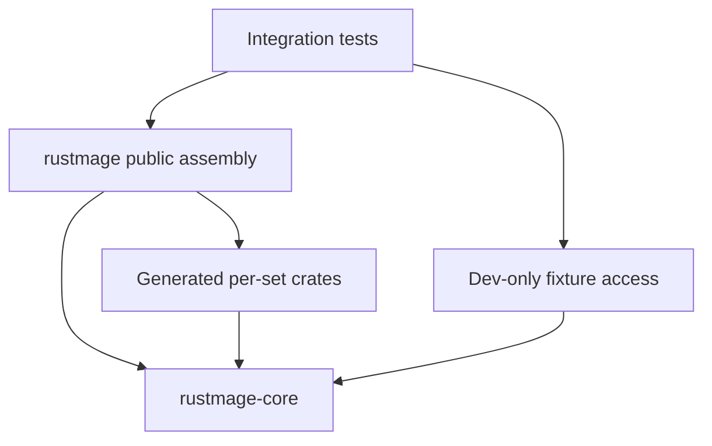

# Engine, set and test compilation

Applications declare one `rustmage` dependency and keep the existing imports.
Cargo resolves the internal workspace packages automatically. The public package
still produces the Rust library and one `librustmage.so` for Python/C consumers.
There is no runtime plugin loader or separate engine/set shared library to ship.

The dependency direction is:



- `crates/engine/src/` owns shared rule types, game state, rules processing,
  protocol and policy. It does not compile authored cards or catalogue/name data.
- `src/card_definitions/<set>/<slug>.rs` and its provenance JSON remain the
  authoring interface. `scripts/link_catalogue.py` emits each set's package and
  typed metadata under `crates/cards/<set>/`. Generated files are not edited by
  hand. Internal packages are unpublished and resolve within the repository for
  normal path/git dependencies.
- `src/catalogue.rs` and `src/generated/catalogue.rs` assemble immutable references
  to the set definitions, supported-card identities, names and token metadata.
  The engine accesses this exact-version Rust registry through a single immutable
  link symbol. Missing or incompatible assembly fails at link time; no global
  initialization, mutable registration, or per-set engine generics are involved.
- `tests/legacy/` retains the original 3,014 cases. The cases compile as an
  integration target, rather than recompiling engine implementation as unit tests.
  `tests/support/mod.rs` contains shared scenario helpers for new set targets.

For new card work, add a separate integration target such as `tests/msh.rs`,
using `mod support;` and ordinary `rustmage` imports. The repository's internal
dev-dependency enables fixture access to existing engine state and helpers.
`rustmage-test-access` changes visibility only under the internal `test-support`
feature; ordinary consumer builds retain private game state. Synthetic legacy
providers use an explicit dev-only feature as well. These features are not
forwarded as public `rustmage` features.

## What rebuilds

| Change | Expected compilation |
| --- | --- |
| Shared engine rule/type | Engine and its dependent set/assembly/test units |
| One authored card | Its set, the assembly and selected integration target |
| Admission, name or catalogue metadata | Affected set metadata and assembly; engine reused |
| A scenario or test helper | Selected integration targets; production crates reused |

The generator writes only changed outputs. Catalogue IDs are append-only;
`physical_count` counts identities without requiring them to form a prefix.
Existing intrinsic aliases are checked against their compiled IDs. Shared
creature-type vocabulary/accessors regenerate only for a shared rule API change. Adding cards or supported identities
does not put an array length, catalogue version, or name table into the engine.
`Card::ALL` is now a slice-like supported-card view: iteration, indexing, `len`,
`iter`, `as_slice`, and `AsRef<[Card]>` work without baking the admission count
into engine code. Code requiring a fixed `[Card; N]` should collect the view into
its chosen owned container. Existing intrinsic aliases such as `Card::Forest`
remain shared vocabulary; ordinary new cards use catalogue lookup/typed IDs.

The test profile optimizes the stable engine and external dependencies at level
1, while card metadata and test bodies use level 0. This preserves complete-game
execution speed and keeps ordinary card/test compilation light. Optimized release
builds retain the existing thin LTO profile. Profiles and fixture feature sets
have separate Cargo artifacts; keep them stable during a card-authoring phase.

## Engine-first set implementation

Before writing cards, inspect the whole set's Oracle/XMage obligations and list
every needed engine mechanic, correction, rule interaction and performance change.
Implement and validate that complete list first. Review the shared changes, then
regenerate set linkage and warm the test cache before starting card definitions.
If a missing engine dependency appears later, finish that engine checkpoint
before resuming dependent cards. The set implementation skill specifies this
workflow in detail.

Use the guarded, reusable cache for local work:

```sh
python3 scripts/link_catalogue.py
python3 scripts/resource_guard.py -- cargo test --test legacy --no-run
python3 scripts/resource_guard.py -- cargo test --test msh card_or_module_filter
```

`cargo test` from the repository runs its integration targets by default. A filter
selects execution inside its target; it does not avoid compiling that target's
other cases. New set targets keep that compilation separate from the large
inherited suite. To use bounded focused execution, select the existing target:

```sh
python3 scripts/run_native_tests.py --test-target legacy --filter manifest \
  --target-dir /path/to/warm/target --report /path/under/home/cache/native.json
```

Full acceptance remains `python3 scripts/validate.py --release --python smoke`.
The native runner compiles integration targets, executes each serially in one
process, accounts for every selected case, and enforces case/suite timeouts.
No engine unit-test executable is needed. Never run an unguarded Cargo build or
clean an active/reusable target; preserve required library snapshots unchanged.

## CI cache reuse

The compiled cache restore prefix survives additions to workspace manifests and
lockfiles. Cargo still validates dependency versions, flags and crate inputs.
`scripts/build_cache.py` records SHA256 and timestamps of compile inputs only
after successful validation. After a fresh checkout, it restores a timestamp
only when the compiler/context and actual file contents match. Changed/new files
receive fresh timestamps. Artifact files are never touched or declared fresh by
this script. This avoids rebuilding unchanged engine source just because Git
assigned new checkout timestamps, while preserving normal Cargo invalidation.

## Measured rebuilds

The retained 3,014-case harness compiled after a card edit in **24.57s** and after
an individual test edit in **21.37s** (three-sample medians, cached dependencies).
Cargo confirmed that card edits reused the engine and every other set, and test
edits reused all production crates. A final-source confirmation measured 24.52s
and 21.51s respectively. A complete simulated checkout of all 12,709 inputs, including embedded TSV data,
followed by content-verified restoration left all artifacts fresh (0.22s Cargo check).
These are compilation measurements; samples execute one existing focused case.
Full-suite execution is recorded separately by acceptance. No clean builds ran.
See [build-split-results.json](build-split-results.json) for controls and evidence.
